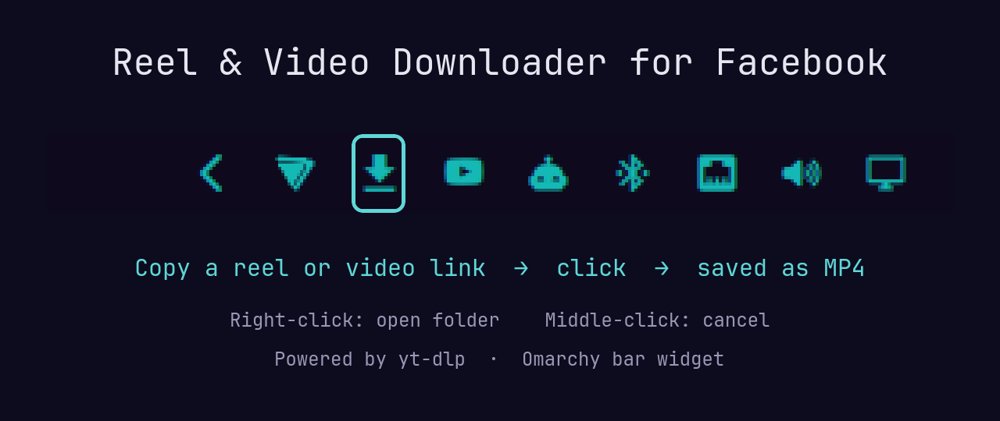

# Reel & Video Downloader for Facebook (Omarchy plugin)

A bar button for Omarchy: copy a Facebook **reel or video** link, click the button, and the video is saved as an MP4. It uses [yt-dlp](https://github.com/yt-dlp/yt-dlp) for the download.



Not affiliated with or endorsed by Meta or Facebook. Only download videos you have the right to save.

## Install

```sh
omarchy plugin add https://github.com/thestandardissue/omarchy-fbdl.git --enable
```

### Dependencies

```sh
sudo pacman -S --needed yt-dlp ffmpeg wl-clipboard libnotify
```

- `yt-dlp` downloads the video
- `ffmpeg` merges the video and audio into one MP4
- `wl-clipboard` reads the link from your clipboard
- `libnotify` shows desktop notifications

## Use

| Action | What it does |
| --- | --- |
| Left click | Download the Facebook link in your clipboard |
| Right click | Open the download folder |
| Middle click | Cancel the current download |

Works with videos, reels and `fb.watch` links. **Stories aren't supported**, because yt-dlp can't download them.

## Settings

- **Download folder**: where videos are saved (default `~/Downloads/facebook`).
- **Use cookies from browser**: for private or friends-only videos. Pick the browser you're logged into Facebook with, and yt-dlp reads your login cookies from it. Leave it on `none` for public videos.

## Keybind (optional)

You can also run the script without the bar. Add to `~/.config/hypr/bindings.lua`:

```lua
o.bind("SUPER + SHIFT + F", "Download Facebook video", "~/.config/omarchy/plugins/io.github.thestandardissue.fbdl/scripts/fbdl")
```

## Command line

```sh
scripts/fbdl [url] [output-dir] [cookies-browser]
```

The URL defaults to your clipboard.

## What it runs

Plugins run unsandboxed with your user's permissions. This one only runs `scripts/fbdl`, which runs `yt-dlp`, `wl-paste` and `notify-send`, plus `xdg-open` to open the download folder. It doesn't need root, run in the background or connect anywhere except the video link you give it. If you turn on the cookies setting, yt-dlp reads your Facebook login cookies from the browser you choose.

## Uninstall

Remove it in the Omarchy plugin settings, or delete `~/.config/omarchy/plugins/io.github.thestandardissue.fbdl`.

## License

MIT
